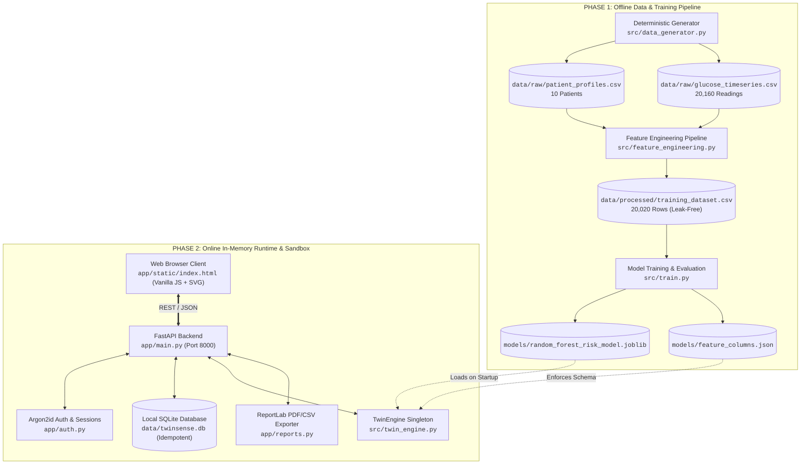

# TwinSense AI: Predictive Healthcare Digital Twin Prototype

[](https://www.python.org/)
[](https://fastapi.tiangolo.com/)
[](https://scikit-learn.org/)
[](#6-architecture-overview)
[](#12-how-to-run-tests)
[](LICENSE)
[](#-mandatory-ethical--clinical-disclaimer)

---

## 📌 Project Submission Details

This section contains the official submission information required by the project review committee.

### 1. Team Details
| Role | Name | Email | GitHub / LinkedIn |
| :--- | :--- | :--- | :--- |
| **Team Lead / ML Engineer** | `[Insert Team Lead Name]` | `[Insert Team Lead Email]` | `[Insert Profile Link]` |
| **Backend & Systems Engineer** | `[Insert Member 2 Name]` | `[Insert Member 2 Email]` | `[Insert Profile Link]` |
| **Frontend & UI/UX Developer** | `[Insert Member 3 Name]` | `[Insert Member 3 Email]` | `[Insert Profile Link]` |
| **Domain / Clinical Advisor** | `[Insert Member 4 / Advisor Name]` | `[Insert Advisor Email]` | `[Insert Profile Link]` |

> *Note: Replace bracketed placeholders above with your official team member credentials.*

### 2. College / Incubator Information
* **Institution / College Name:** `[Insert College / University / Institute Name]`
* **Department / School:** `[Insert Department, e.g., Department of Computer Science & Engineering]`
* **Incubator / Innovation Center (if applicable):** `[Insert Incubator / Center of Excellence Name, or N/A]`
* **Campus Location:** `[Insert City, State, Country]`
* **Academic Year / Cohort:** `[Insert Academic Year, e.g., 2025–2026]`

### 3. Project Title
* **Official Title:** **TwinSense AI**
* **Subtitle:** Predictive Healthcare Digital Twin Prototype for Continuous Glycemic Risk Estimation and Non-Destructive In-Silico Counterfactual Simulation

### 4. Problem Statement
People living with diabetes experience rapid, volatile glucose fluctuations that can precipitate acute hyperglycemia (hyperosmolar state, ketoacidosis risk) or acute hypoglycemia (loss of consciousness, seizure). Current standard-of-care Continuous Glucose Monitoring (CGM) systems provide point-in-time readings and trend arrows, but a current reading alone does not reveal where glycemic trajectory is heading over the next 45 minutes under changing physiological dynamics. 

This latency in risk awareness complicates proactive decision-making and leads to delayed corrective actions. Furthermore, patients and clinical researchers lack a risk-free computational environment to safely evaluate the glycemic impact of behavioral choices (e.g., light postprandial activity vs. rest) prior to taking physical action.

### 5. Healthcare Use Case
* **Target Patient Population:** Individuals diagnosed with Type 1 or Type 2 Diabetes Mellitus undergoing continuous glucose monitoring.
* **Clinical Setting:** Pre-clinical exploratory research, patient self-management decision support, and digital twin simulation sandboxes.
* **Primary Use Cases:**
  1. **Early 45-Minute Forward Risk Stratification:** Anticipates whether a patient's glycemic state will be In-Range ($70\text{--}180\text{ mg/dL}$) or Hyperglycemic ($>180\text{ mg/dL}$) 45 minutes ahead, giving users an actionable lead time.
  2. **Non-Destructive What-If Counterfactual Sandbox:** Empowers users to test hypothetical physiological adjustments (e.g., simulating $+1,000$ steps or a $\pm 30\text{ mg/dL}$ shift in recent glucose) on an in-memory telemetry clone without mutating real clinical records.
  3. **Physiological Explainability:** Exposes key contributing physiological indicators (15m rate of change, 30m rolling mean, baseline HbA1c, meal events) alongside calibrated class probabilities.
  4. **Rule-Based Low-Glucose Safety Guardrails:** Implements independent, immediate safety alerts strictly based on verified measured glucose readings ($<70\text{ mg/dL}$), completely decoupled from ML inference, with clear non-clinical emergency instructions.

### 6. Technical Stack
| Domain | Technology / Library | Version / Specification | Role in Project |
| :--- | :--- | :--- | :--- |
| **Core Runtime** | Python | `>=3.10`, tested on `3.14.2` | Core backend, pipeline logic, ML engine |
| **API Framework** | FastAPI | `>=0.110.0` | Asynchronous high-throughput REST API |
| **ASGI Web Server** | Uvicorn | `>=0.28.0` | Production ASGI web server with auto-reload |
| **Data Validation** | Pydantic v2 | `>=2.6.0` | Strict data validation, request/response contracts |
| **Machine Learning** | Scikit-Learn | `>=1.4.0` | Random Forest classifier, metrics, benchmarking |
| **Data Processing** | Pandas & NumPy | `>=2.2.0` / `>=1.26.0` | Time-series rolling windows, feature matrix extraction |
| **Model Persistence** | Joblib | `>=1.3.0` | Compressed artifact serialization |
| **Database** | SQLite3 | Python Built-in | Local relational store for patients, readings, audit trails |
| **Report Generation** | ReportLab | `>=4.0.0` | Clinical-grade PDF report synthesis |
| **Authentication** | Argon2-cffi | `>=25.1.0` | RFC 9106 Argon2id password hashing & secure sessions |
| **Testing Suite** | Pytest & PyPDF | `>=8.0.0` / `>=5.0.0` | 123 automated unit, integration, and PDF tests |
| **Frontend UI** | Vanilla HTML5, CSS3, JS | Modern ES6+, SVG | Self-contained, zero-dependency, local-first dashboard |

### 7. AI/ML Model and Framework Details
* **Framework:** Scikit-Learn (`scikit-learn >= 1.4.0`)
* **Primary Model Architecture:** Balanced Random Forest Classifier (`RandomForestClassifier(n_estimators=100, max_depth=8, class_weight='balanced', random_state=42)`)
* **Baseline Benchmark:** Unlearned majority-class `DummyClassifier(strategy='most_frequent')`
* **Input Feature Space (11 Dimensions):**
  1. `glucose_rolling_mean_15m`: Short-term 15-minute moving average
  2. `glucose_rolling_mean_30m`: Intermediate 30-minute moving average
  3. `glucose_rate_of_change_15m`: Glycemic velocity ($\Delta\text{mg/dL} / 15\text{m}$)
  4. `steps_sum_30m`: Accumulated physical step count over past 30 minutes
  5. `heart_rate_mean_30m`: Mean cardiovascular exertion over past 30 minutes
  6. `minutes_since_last_meal`: Elapsed time since recorded carbohydrate intake
  7. `age`: Patient chronological age (years)
  8. `bmi`: Body Mass Index ($\text{kg/m}^2$)
  9. `baseline_hba1c`: Glycated hemoglobin percentage
  10. `diabetes_type`: Categorical indicator (1 = Type 1, 2 = Type 2)
  11. `diabetes_duration_years`: Chronicity of diabetes diagnosis
* **Prediction Horizon:** Exactly 45 minutes into the future ($t + 45\text{ minutes}$, corresponding to 9 sampling intervals of 5 minutes).
* **Temporal Partitioning & Leakage Prevention:**
  * Strict chronological 80% train / 20% test split conducted per patient.
  * **45-minute embargo buffer (9 consecutive samples per patient)** discarded at the split boundary to prevent lookahead target overlap.
* **Evaluation Performance on Held-Out Test Set (N = 3,920):**
  * Overall Accuracy: **89.29%** (vs. Dummy Baseline: 55.20%, **+34.08% improvement**)
  * Macro F1-Score (Active Classes): **0.8917** (vs. Dummy Baseline: 0.3557, **+0.5360 improvement**)
* **Transparent Limitation Disclosure (Class 1 - Hypoglycemia):**
  * The synthetic dataset contains elevated baselines without simulated severe insulin overdosing; hence, Class 1 samples equal **0 in training and 0 in testing**.
  * The system **never claims** to detect, predict, or rule out hypoglycemia. Class 1 probability is displayed as `"Not supported"`, backed by prominent warning banners and an independent rule-based alert triggered on measured readings $<70\text{ mg/dL}$.

### 8. Project Video Demo Link
* **Video Title:** TwinSense AI — Complete Architecture, ML Pipeline, and Live Dashboard Demonstration
* **Duration:** 15–20 minutes
* **Platform:** YouTube (Unlisted / Public)
* **Access Link:** [https://youtu.be/rW0ezS9FJXc](https://youtu.be/rW0ezS9FJXc)
* *Video Agenda:*
  1. *00:00–03:00*: Executive introduction, problem statement, and clinical context
  2. *03:00–06:30*: Digital Twin architecture, synthetic generation, and leak-free feature engineering
  3. *06:30–10:00*: Machine learning training, embargo buffer, and evaluation metrics
  4. *10:00–15:00*: Live interactive dashboard walkthrough: patient selection, 45m risk forecast, what-if counterfactual sandbox, and CSV/PDF report download
  5. *15:00–18:30*: Safety guardrails, independent low-glucose alert, honest hypoglycemia limitation, and test suite execution

### 9. Open-Source License Details
* **License:** **MIT License**
* **SPDX License Identifier:** `MIT`
* **License File:** [`LICENSE`](LICENSE) (located at project repository root)
* **Terms:** Highly permissive open-source license granting anyone free of charge the right to use, copy, modify, merge, publish, distribute, sublicense, and/or sell copies of the software, provided the original copyright notice and permission notice are preserved.
* **Disclaimer:** Includes standard warranty disclaimers stating that the software is provided "AS IS", without warranty of any kind.

### 10. System Architecture Diagram Document Link
* **Exported Architecture PDF (Local File):** [`reports/system_architecture_diagram.pdf`](reports/system_architecture_diagram.pdf) *(17x11" Landscape Vector Diagram)*
* **Mermaid Source File (Repository):** [`reports/system_architecture.mmd`](reports/system_architecture.mmd)
* **Technical Architecture Specification (Repository):** [`reports/system_architecture.md`](reports/system_architecture.md)
* **External PDF/PPT Link (Cloud):** `[Insert Architecture Diagram PDF/PPT Link (e.g., Google Drive / GitHub Releases)]`

### 11. Project Presentation Document Link
* **Presentation Format:** 12-Slide Professional Slide Deck (16:9 Widescreen)
* **Slide Deck Title:** TwinSense AI: Predictive Healthcare Digital Twin Prototype
* **Editable PowerPoint (Local File):** [`reports/TwinSense_AI_Presentation.pptx`](reports/TwinSense_AI_Presentation.pptx)
* **Presentation PDF (Local File):** [`reports/TwinSense_AI_Presentation.pdf`](reports/TwinSense_AI_Presentation.pdf)
* **External PDF/PPT Link (Cloud):** `[Insert Project Presentation PDF/PPT Link (e.g., Google Drive / GitHub Releases)]`

### 12. Public Accessibility Verification Checklist
Before submitting, verify that all external links comply with the submission guidelines:
- [ ] **Repository Access:** GitHub repository is set to **Public**.
- [ ] **Demo Video Access:** YouTube video is set to **Unlisted** or **Public** (playable without login).
- [ ] **Architecture Diagram Access:** Shared link permissions set to **"Anyone with the link can view"**.
- [ ] **Presentation Slide Deck Access:** Shared link permissions set to **"Anyone with the link can view"**.
- [ ] **Executable Code:** All test suites pass cleanly with standard dependencies (`python -m pytest -v`).

---

## ⚠️ Mandatory Ethical & Clinical Disclaimer

> [!CAUTION]
> **FOR RESEARCH, EDUCATIONAL, AND DEMONSTRATION PURPOSES ONLY.**
>
> 1. **100% Synthetic Data:** All patient records, CGM telemetry, vitals, and activity profiles in this repository are **purely synthetic** and generated algorithmically via mathematical simulations. They do not represent real human medical data.
> 2. **Simplified Endocrinology:** The simulation employs heuristic mathematical representations (circadian baselines, postprandial glucose curves, and step-based glucose clearance) and **does not accurately model complex human endocrinology** (such as subcutaneous insulin-on-board pharmacokinetics, gastric emptying rates, hormonal counter-regulation, or acute illness).
> 3. **Not Clinically Validated:** TwinSense AI has not undergone clinical trials, is **not approved by any regulatory authority (FDA, CE, CDSCO)**, and must **NEVER** be used for medical diagnosis, clinical treatment, or insulin dosage calculation.
> 4. **Hypoglycemia Limitation:** The current machine learning model **does not support hypoglycemia prediction**. If an observed glucose reading is strictly below $70\text{ mg/dL}$, a rule-based safety alert activates based solely on the measured reading, urging users to seek medical help if experiencing symptoms.

---

## 📋 Table of Contents

- [Project Submission Details](#-project-submission-details)
- [Mandatory Ethical & Clinical Disclaimer](#-mandatory-ethical--clinical-disclaimer)
- [Key Features](#-key-features)
- [System Architecture](#-system-architecture)
- [Project Directory Layout](#-project-directory-layout)
- [Environment Setup & Installation](#-environment-setup--installation)
- [End-to-End Execution Pipeline](#-end-to-end-execution-pipeline)
- [Starting the Application](#-starting-the-application)
- [How to Run Tests](#-how-to-run-tests)
- [REST API Reference](#-rest-api-reference)
- [Model Evaluation & Honest Metrics](#-model-evaluation--honest-metrics)
- [Submission Document Checklist](#-submission-document-checklist)

---

## 🚀 Key Features

* **Deterministic Multi-Patient Synthetic Generator (`src/data_generator.py`):**
  * Synthesizes 10 clinically diverse patient profiles (Type 1 and Type 2 diabetes) across 7 continuous days at 5-minute sampling intervals (20,160 total readings).
  * Seeded deterministically (`seed=42`) with zero nulls and verified physiological bounds `[40.0, 400.0]` mg/dL.
* **Leak-Free Past-Only Feature Engineering (`src/feature_engineering.py`):**
  * Extracts 11 past-only rolling statistical features (15m/30m rolling means, rate of change, step sums) combined with static EHR features.
  * Enforces strict chronological per-patient partitioning with an **embargo buffer of 45 minutes** to prevent temporal target leakage.
* **Trained Machine Learning Classifier (`src/train.py`):**
  * Balanced Random Forest Classifier evaluated against an unlearned majority-class `DummyClassifier`.
  * Achieves **89.29% accuracy** and **0.8917 Macro F1** on the chronological holdout test set.
* **Interactive Digital Twin Engine (`src/twin_engine.py`):**
  * Modular in-memory inference pipeline validating chronological ordering and minimum history constraints ($\ge 30$ minutes of readings).
  * Counterfactual what-if simulation engine performing non-destructive, read-only perturbations on telemetry clones.
* **Independent Low-Glucose Safety Alert:**
  * Rule-based check triggered solely if the measured glucose reading is strictly $<70\text{ mg/dL}$.
  * Operates completely independently of ML inference and activates immediately upon patient selection without requiring a forecast run.
  * Zero insulin/medication dosing advice; clear non-clinical emergency guidance.
* **Local-First REST API (`app/main.py`):**
  * High-performance asynchronous FastAPI service with strict Pydantic v2 schemas and Argon2id session security.
  * Automated SQLite database initialization (`data/twinsense.db`) with idempotent data population from raw CSVs.
  * Complete inference audit logging and downloadable clinical prediction reports in CSV and PDF formats.
* **Pure Native Responsive Dashboard (`app/static/`):**
  * Modern clinical dark/lavender aesthetic utilizing glassmorphism and CSS variables.
  * Custom pure SVG telemetry chart calculating mathematical coordinates without external charting libraries.
  * Zero external JavaScript/CSS frameworks or CDN dependencies; 100% self-contained and offline-capable.

---

## 🏗️ System Architecture

The system is decoupled into two primary operational phases: an **Offline Batch Data & ML Pipeline** and an **Online In-Memory Runtime & Interactive Sandbox**.



---

## 📁 Project Directory Layout

```text
TwinSense-AI/
├── .gitignore                       # Git exclusion rules (caches, local DBs, environments)
├── LICENSE                          # MIT Open-Source License
├── requirements.txt                 # Pinned project dependencies
├── README.md                        # Official project guide and submission documentation
│
├── app/                             # FastAPI Web Application & Backend Services
│   ├── main.py                      # Application entrypoint, CORS, lifespan, routes
│   ├── auth.py                      # Argon2id password hashing, CSRF, and session security
│   ├── database.py                  # SQLite schema creation, connection manager, CSV seeder
│   ├── reports.py                   # Downloadable CSV and PDF prediction report generators
│   ├── schemas.py                   # Pydantic v2 validation models for requests/responses
│   ├── services.py                  # Database queries, pagination, and prediction persistence
│   ├── suggestions.py               # Rule-based physiological insights and disclaimers
│   └── static/                      # Self-contained frontend dashboard (no build tools needed)
│       ├── index.html               # Semantic UI with KPI cards, sandbox, and disclaimer banners
│       ├── login.html               # Secure login interface
│       ├── register.html            # User registration interface
│       ├── style.css                # Deep violet/teal clinical theme, glassmorphism, responsive grid
│       └── app.js                   # Client controller, state management, pure SVG chart engine
│
├── data/                            # Project Datasets
│   ├── raw/                         # Raw deterministic CSV files
│   │   ├── patient_profiles.csv     # 10 synthetic baseline patient EHR profiles
│   │   └── glucose_timeseries.csv   # 20,160 5-minute CGM & wearable telemetry records
│   ├── processed/                   # Prepared datasets
│   │   └── training_dataset.csv     # 20,020 leak-free engineered feature-target pairs
│   └── twinsense.db                 # [LOCAL RUNTIME] Auto-generated SQLite database (git-ignored)
│
├── docs/                            # Domain Specifications
│   └── problem_statement.md         # Comprehensive problem statement & clinical scope
│
├── models/                          # Machine Learning Artifacts
│   ├── feature_columns.json         # Strict 11-feature ordered schema contract
│   └── random_forest_risk_model.joblib # Serialized Random Forest classifier (depth 8)
│
├── reports/                         # Technical Reports & Audit Documentation
│   ├── evaluation_report.md         # Detailed metrics, confusion matrix, and feature importances
│   ├── model_evaluation.md          # In-depth comparative analysis (Random Forest vs Dummy)
│   ├── system_architecture.md       # Technical architecture specification and data flows
│   ├── system_architecture.mmd      # Standalone Mermaid architecture diagram source
│   ├── final_test_report.md         # Test execution log
│   └── final_submission_checklist.md # Pre-submission verification log
│
├── src/                             # Core Data Science & Engine Modules
│   ├── data_generator.py            # Deterministic multi-patient synthetic physiology simulation
│   ├── feature_engineering.py       # Past-only rolling window transformations & 45m target alignment
│   ├── train.py                     # Chronological train/test split, 45m embargo, and model training
│   └── twin_engine.py               # TwinEngine inference class and counterfactual simulation
│
└── tests/                           # Automated Verification Suite (123 Tests)
    ├── test_api.py                  # API route integration tests
    ├── test_auth.py                 # Argon2id password hashing, CSRF, and session tests
    ├── test_hypoglycemia_limitation.py # Hypoglycemia limitation & low-glucose alert tests
    ├── test_phase3.py               # Data split integrity and multi-split validation
    ├── test_safety.py               # Safety guardrails and disclaimer tests
    ├── test_suggestions.py          # Clinical suggestion safety tests
    └── test_twin_engine.py          # TwinEngine logic, bounds, and immutability tests
```

---

## ⚙️ Environment Setup & Installation

### Step 1: Clone or Navigate to the Project Directory
```powershell
cd "C:\Users\Narayanan R\OneDrive\Desktop\TwinSense-AI"
```

### Step 2: Create and Activate a Dedicated Virtual Environment
```powershell
# Create virtual environment
python -m venv .venv

# Activate on Windows PowerShell
.\.venv\Scripts\Activate.ps1

# (Alternative for macOS/Linux)
# source .venv/bin/activate
```

### Step 3: Install Verified Dependencies
```powershell
python -m pip install --upgrade pip
python -m pip install -r requirements.txt
```

Verify that all dependencies installed cleanly:
```powershell
python -m pip check
```
*Expected output: `No broken requirements found.`*

---

## 🔬 End-to-End Execution Pipeline

To regenerate all synthetic datasets, extract features, and retrain the machine learning model from scratch:

```powershell
# 1. Generate Raw Synthetic Data (10 patients, 20,160 readings)
python src/data_generator.py

# 2. Run Past-Only Feature Engineering (20,020 leak-free samples)
python src/feature_engineering.py

# 3. Train Model with 45-Minute Embargo Buffer
python src/train.py
```

---

## 🌐 Starting the Application

### Start the FastAPI Server:
```powershell
python -m uvicorn app.main:app --reload --host 127.0.0.1 --port 8000
```

### Accessing the Web Services:
* **Interactive Dashboard:** [http://127.0.0.1:8000/](http://127.0.0.1:8000/)
* **Interactive API Documentation (Swagger UI):** [http://127.0.0.1:8000/docs](http://127.0.0.1:8000/docs)
* **Alternative API Documentation (ReDoc):** [http://127.0.0.1:8000/redoc](http://127.0.0.1:8000/redoc)

---

## 🧪 How to Run Tests

The project includes 123 automated test cases covering model immutability, leak-free feature boundaries, authentication security, safety warnings, and report generation:

```powershell
# Run the complete test suite
python -m pytest -v
```

*Expected output: `123 passed in ~10.8s (100% passing)`*

---

## 📡 REST API Reference

| Method | Endpoint | Description | Request Body | Response |
| :---: | :--- | :--- | :---: | :---: |
| `GET` | `/api/health` | System health, model readiness, record counts, and limitation warnings. | None | `200` |
| `GET` | `/api/patients` | List all 10 synthetic patients with baseline metadata and latest CGM reading. | None | `200` |
| `GET` | `/api/patients/{patient_id}` | Retrieve static EHR baseline profile for a specific patient. | None | `200`, `404` |
| `GET` | `/api/patients/{patient_id}/readings?limit=50` | Retrieve chronological CGM, heart rate, and step readings for plotting. | None | `200`, `404` |
| `POST` | `/api/patients/{patient_id}/predict` | Runs 45-minute forward risk inference via TwinEngine; logs audit record. | `{}` (Optional) | `201`, `404` |
| `GET` | `/api/patients/{patient_id}/predictions` | Retrieve historical prediction logs for the patient. | None | `200`, `404` |
| `POST` | `/api/patients/{patient_id}/what-if` | Non-destructive counterfactual simulation ($\Delta$ glucose, $\Delta$ steps). | `WhatIfRequest` JSON | `200`, `404` |
| `GET` | `/api/patients/{patient_id}/report/csv` | Download complete clinical prediction audit report in CSV format. | None | `200`, `404` |
| `GET` | `/api/patients/{patient_id}/report/pdf` | Download formatted clinical prediction report as PDF. | None | `200`, `404` |

---

## 📊 Model Evaluation & Honest Metrics

### Hold-Out Benchmark Performance (Untouched Test Set, N = 3,920)

| Evaluation Metric | Baseline (Dummy Classifier) | Random Forest (`max_depth=8`) | Delta / Improvement |
| :--- | :---: | :---: | :---: |
| **Overall Accuracy** | 55.20% | **89.29%** | **+34.08%** |
| **Macro F1-Score (Active Classes)** | 0.3557 | **0.8917** | **+0.5360** |

### Per-Class Detailed Performance
| Risk Class | Clinical Definition | Precision | Recall | F1-Score | Test Support |
| :--- | :--- | :---: | :---: | :---: | :---: |
| **Class 1** | Hypoglycemia ($<70\text{ mg/dL}$) | **0.0000** | **0.0000** | **0.0000** | **0** *(Unsupported)* |
| **Class 2** | In-Range ($70\text{--}180\text{ mg/dL}$) | 0.8800 | 0.8810 | 0.8805 | 1,756 |
| **Class 3** | Hyperglycemia ($>180\text{ mg/dL}$) | 0.9033 | 0.9025 | 0.9029 | 2,164 |

### Confusion Matrix (Untouched Chronological Test Set)
```text
                  Predicted
Actual       Hypo (1)   In-Range (2)   Hyper (3)
Hypo (1)         0            0              0
In-Range (2)     0         1,547            209
Hyper (3)        0           211          1,953
```

---

## 📑 Submission Document Checklist

| Required Submission Item | Current Status | Location / Artifact Path | Action Required Prior to Final Submission |
| :--- | :---: | :--- | :--- |
| **1. Open-Source License** | ✅ **EXISTS** | [`LICENSE`](LICENSE) (MIT License) | None; fully configured and active. |
| **2. Architecture Specification** | ✅ **EXISTS** | [`reports/system_architecture.md`](reports/system_architecture.md) & [`.mmd`](reports/system_architecture.mmd) | Complete technical specification and Mermaid source code. |
| **3. Architecture PDF Diagram** | ✅ **EXISTS** | [`reports/system_architecture_diagram.pdf`](reports/system_architecture_diagram.pdf) | Generated 17x11" vector PDF diagram ready for submission. |
| **4. Project Presentation (PPTX/PDF)** | ✅ **EXISTS** | [`reports/TwinSense_AI_Presentation.pptx`](reports/TwinSense_AI_Presentation.pptx) & [`.pdf`](reports/TwinSense_AI_Presentation.pdf) | 12-slide presentation in both editable PowerPoint and PDF formats. |
| **5. Unlisted YouTube Demo Video** | ✅ **EXISTS** | [https://youtu.be/rW0ezS9FJXc](https://youtu.be/rW0ezS9FJXc) | Verified YouTube demonstration video. |
| **6. Team & College Placeholders** | ⚠️ **ACTION REQ.** | Section 1 & Section 2 of this README | Fill in actual names, college/incubator names, and contact details. |

---

*TwinSense AI — Healthcare Digital Twin Prototype — Developed for academic innovation, healthcare engineering, and research demonstration.*
